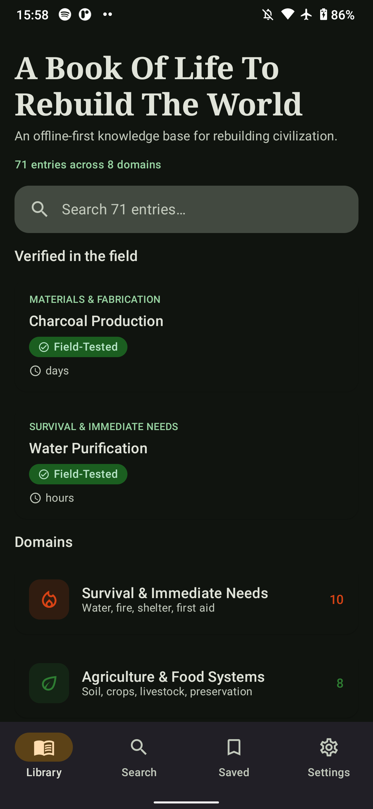
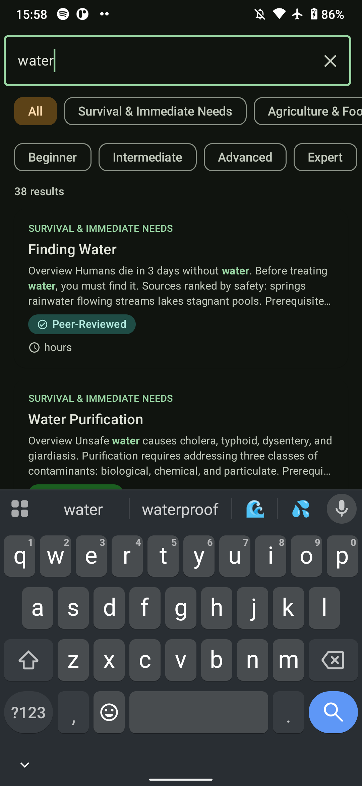
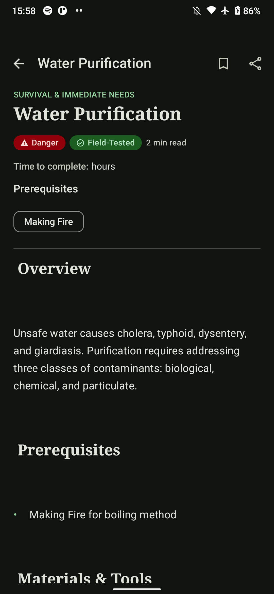
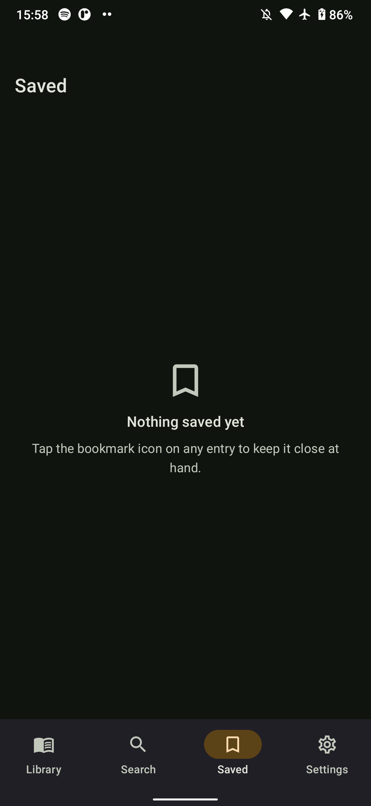
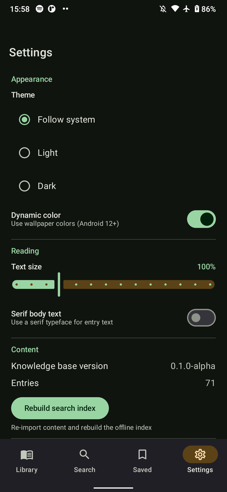

# A Book Of Life — Android App

An offline-first, native Android reader for the *A Book Of Life To Rebuild The World*
knowledge base. Written in Kotlin with Jetpack Compose and Material 3, it packages the
entire knowledge base into the APK so it works with **zero connectivity**.

## Features

- **Offline knowledge base** — all entries, sidecar metadata and Markdown bodies are
  bundled as assets and imported into a local Room database on first launch.
- **Hybrid search** — SQLite FTS4 candidate retrieval fused with an in-memory BM25 +
  TF-IDF (cosine) ranker via Reciprocal Rank Fusion, with matched terms highlighted in
  results. Filter by domain and difficulty.
- **Rich reader** — a Compose Markdown renderer (headings, lists, blockquotes, code,
  tables, links, emphasis) with adjustable text size, optional serif body text, reading
  time, safety/difficulty/verification badges and prerequisite links.
- **Bookmarks & progress** — save entries and resume reading where you left off.
- **Themes** — Material 3 light/dark, dynamic color on Android 12+, and a parchment
  "field manual" accent palette.
- **Localization** — 8 UI translations (ar, de, es, fr, hi, pt, sw, zh) generated from
  `i18n/strings/*.yaml`, selectable per app via Android 13+ per-app language settings.
- **In-app updates** — check the project repository for a newer release, download the
  package in the background, and hand it to the system installer from
  **Settings → App updates**. Nothing is fetched unless the reader asks for it.

## Screenshots

| Library | Search | Reader | Saved | Settings |
| --- | --- | --- | --- | --- |
|  |  |  |  |  |


## Architecture

A clean, multi-module Gradle project:

```
android/
├── app/                    # Application, navigation, DI wiring
├── core/
│   ├── model/              # Domain models (pure Kotlin)
│   ├── common/             # Dispatchers, text utilities
│   ├── designsystem/       # Theme, components, shared UI strings
│   └── data/               # Room, DataStore, content importer, search engine
└── feature/
    ├── home/               # Library, domains, continue-reading
    ├── search/             # Search + filters
    ├── reader/             # Markdown reader, bookmarks, share
    ├── bookmarks/          # Saved entries
    └── settings/           # Appearance, reading, content controls
```

- **UI**: Jetpack Compose + Material 3, Navigation Compose, Hilt view models.
- **Data**: Room 2.6, DataStore Preferences, kotlinx.serialization.
- **Concurrency**: Kotlin coroutines + Flow.
- **Markdown**: `org.jetbrains:markdown` (GFM) parsed into Compose.
- **Toolchain**: Kotlin 2.0, AGP 8.7, `minSdk 26`, `targetSdk 35`, Java 17.

## Content pipeline

Content is generated from the repository's source of truth by
`tools/export_content.py`:

```
domains/**/*.md + sidecars/**/*.pnk.yaml + i18n/strings/*.yaml + manifest.toml
        │
        ▼  python android/tools/export_content.py
android/app/src/main/assets/content/{entries,domains,meta}.json
android/core/designsystem/src/main/res/values-<lang>/strings.xml
```

`meta.json` records a content fingerprint (`contentHash`) alongside the KB version, and
the importer re-imports whenever the version, entry count **or** hash changes — so content
refreshes are picked up even when the KB version is not bumped.

The generated files are committed, and CI regenerates them and fails if the working
tree differs — so change the source entries, re-run the exporter, and commit the result.

## Build

Requirements: JDK 17 and the Android SDK (platform 35, build-tools 35.0.0). The Gradle
wrapper pins Gradle 8.9.

```bash
cd android

# Regenerate bundled content first (from the repo root)
python tools/export_content.py

# Build a debug APK
./gradlew assembleDebug

# Install on a connected device
./gradlew installDebug
```

The debug APK is written to `app/build/outputs/apk/debug/app-debug.apk`.

Create `local.properties` (gitignored) if the SDK is not auto-detected:

```properties
sdk.dir=/path/to/Android/Sdk
```

## Testing

```bash
cd android

# JVM unit tests (core:common, core:data, …)
./gradlew test

# Compose instrumentation tests on a connected device/emulator
./gradlew :app:connectedDebugAndroidTest
```

## Continuous integration

[`.github/workflows/android.yml`](../.github/workflows/android.yml) regenerates the
content assets, verifies they are committed, runs the unit tests, assembles the debug
APK and uploads it as a build artifact.

[`.github/workflows/android-emulator.yml`](../.github/workflows/android-emulator.yml)
runs the Compose instrumentation suite on an emulator matrix (API 26 / 31 / 35).

## Release signing

The `release` variant is minified with R8 and signed with a keystore supplied at build
time. Provide the keystore through either environment variables or `android/keystore.properties`
(both gitignored):

```
ABOOK_RELEASE_STORE_FILE=/path/to/release.jks
ABOOK_RELEASE_STORE_PASSWORD=…
ABOOK_RELEASE_KEY_ALIAS=…
ABOOK_RELEASE_KEY_PASSWORD=…
```

```bash
cd android
./gradlew assembleRelease
# -> app/build/outputs/apk/release/app-release.apk
```

If no keystore is configured the release build falls back to the debug key (handy for
local verification, never for distribution). `versionName` and `versionCode` are derived
from `manifest.toml` at the repository root.

## Releasing

[`.github/workflows/android-release.yml`](../.github/workflows/android-release.yml) runs
when a `v*` tag is pushed: it regenerates content, runs the tests, builds a **signed**
release APK and attaches it to a GitHub Release. It expects these repository secrets:

| Secret | Purpose |
| --- | --- |
| `ABOOK_RELEASE_KEYSTORE_BASE64` | base64-encoded `release.jks` |
| `ABOOK_RELEASE_STORE_PASSWORD` | keystore password |
| `ABOOK_RELEASE_KEY_ALIAS` | key alias |
| `ABOOK_RELEASE_KEY_PASSWORD` | key password |

```bash
git tag v0.1.0-alpha && git push origin v0.1.0-alpha
```

## App updates from the settings screen

The app can look for a newer published release and download it from
**Settings → App updates**. Manual behavior is the default. Readers can choose
to check daily, check and download automatically, or check/download and receive
an install-request notification when the APK is ready.

- The check reads the GitHub Releases API for the latest release of the
  project repository. The repository it checks is configured in
  `core/data/src/main/res/values/config.xml`; a fork that ships its own build
  changes those two values.
- Automatic checks are scheduled daily when network connectivity is available,
  subject to Android's background scheduling. Choosing an automatic mode also
  triggers an initial check. On Android 13+, notification permission is
  required so release and install-request alerts can be shown.
- The package is fetched by Android's download service, so the transfer
  continues while the app is closed. Automatic download-only mode waits for the
  reader to start installation from Settings.
- The install-request mode shows a notification when the APK has downloaded.
  Tapping it opens Android's installer. **Android always asks the reader to
  confirm**; an ordinary app cannot install a package silently. On some devices
  Android also asks the reader to allow this app to install packages.
- If the app is closed while the download runs, opening the settings screen
  picks the download up again.

The app declares `INTERNET` and `REQUEST_INSTALL_PACKAGES`. The first is used
only for the update check, and the second is required by Android 8 and later
to show the installer. The app remains fully usable, for reading and for
search, with no network at all.

## License

Code: [MIT](../LICENSE-CODE). Content: [CC BY-SA 4.0](../LICENSE-CONTENT).
